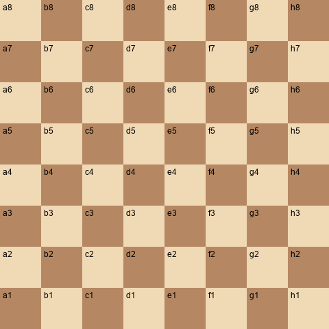

# Chess Position Recognition

Final project for the Intro to Deep Learning course (Fall 2025). Given a photo of a chessboard, the model predicts what is on each of the 64 squares and outputs the position as a FEN string.

[Live demo on Streamlit](https://chessboard-square-classifier-iardjdxpqbydrrvjbyhqoy.streamlit.app/)



## Approach

The board image is split into an 8x8 grid of square crops. Each crop is classified by a ResNet50 (pretrained on ImageNet, then fine-tuned) into one of 13 classes: six white pieces, six black pieces, or empty. The 64 predictions are put back together into a board and converted to FEN. Squares the model can't classify are marked as unknown.

The model was trained on Google Colab with leave-one-game-out cross-validation and light augmentation (color jitter and small rotations). Accuracy on held-out games was about 98.8%.

## Running

```bash
pip install -r requirements.txt
```

Download the model weights from [Google Drive](https://drive.google.com/drive/folders/1NIhXsA4fIA4Ge7ooqqBfdrTkuDlXvCq9) and save them as `checkpoints/best_model.pth`. Then:

```bash
python evaluate.py --image path/to/board.jpg --show-tensor   # predict one image
streamlit run streamlit_app.py                                # run the demo locally
```

To train from scratch:

```bash
python -m dataset_tools.make_dataset --data_root Data --out_root dataset_out
python src/train.py --manifest dataset_out/dataset_manifest.csv
```

## Structure

- `src/`: dataset, model, training and inference
- `dataset_tools/`: square extraction and FEN utilities
- `notebooks/`: the Colab training notebook
- `evaluate.py`: `predict_board(image)`, returns an 8x8 tensor of class IDs
- `streamlit_app.py`: the web demo

## Team

Nikol Kofman, Ariel Shvarts and Yaakov Gerelter. I worked mainly on the dataset, model, training and inference code in `src/`. The original team repository is [here](https://github.com/arikshvarts/chessboard-square-classifier).
